# How to make your own Starbie!

Hey there! Want to make your own Starbie but have no clue where to start? Right this way!


In this guide, we'll go over how to make a simple 2-key Starbie with an MPU6050 and DHT11 Environment Sensor, step by step.

This process will be in 2 main parts:

1. PCB Design
    1. Drawing the schematic
    2. PCB Layout
    3. Export
2. Firmware!

If anything is unclear, 9 times out of 10 you can usually google it; though PLEASE send what you're stuck on into #half-life!

First we will start with:

## Designing your PCB

For this guide we're going to be using [KiCad](https://www.kicad.org/), which is an open source PCB design tool.

To start, we're going to have to import the necessary footprints. For this guide, I've created a guide for you called [the care package](https://github.com/SharKingStudios/Starbie/blob/main/Week%201%20Care%20Package.zip)!

Once that's downloaded, you should end up with a file called "Week 1 Care Package.zip" - unzip that and you'll end up with a bunch of files like this:

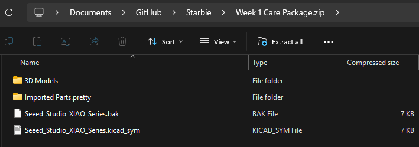

The .sym files are symbol libraries, while the .pretty folder contains the footprint libraries. **You'll have to search up how to install them - I find YouTube works best!**

## Schematic Editor

The schematic of a PCB is what defines all the different connections of your PCB, so we're going to start with it first!

First, open KiCad and create a new project, then click on the "Schematic Editor" button:


This should open up the schematic editor. Once you're in, press the A key on your keyboard. This should open up a menu where you can add components.

Here we will be adding all the components we need. In the end you will end up with something like this:

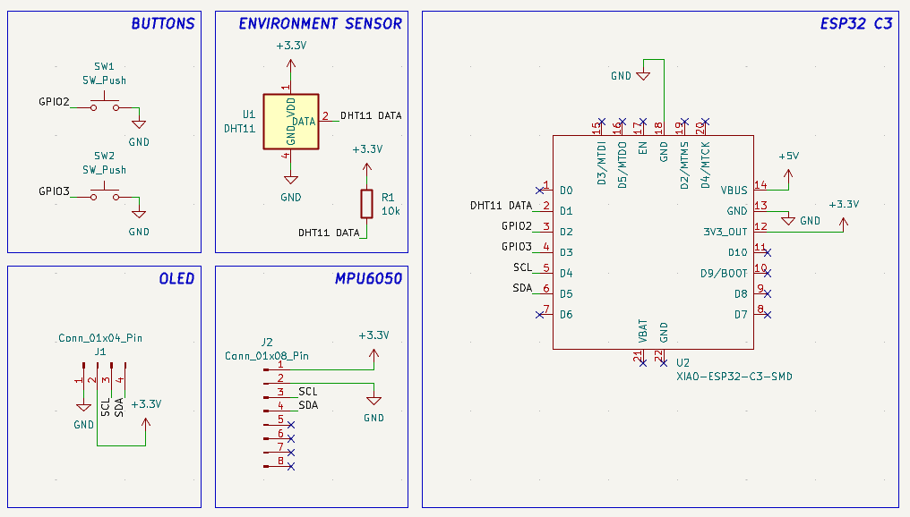

Search for and add the XIAO-ESP32-C3 (This will be our microcontroller!)

Press P to add in the +5V, +3.3V and GND symbols.
Create a net label by pressing L on your keyboard and naming the net.

Finally wire all of those together like this:

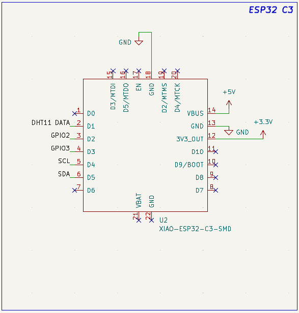

*(The net labels tell the schematic that those parts need to be connected without having to draw wires all over.)*

Next, we need to add in the buttons to allow for some interaction with our Starbie. (Add a SW_Push symbol.)

Connect one side of the button to a net and the other side to GND like this:

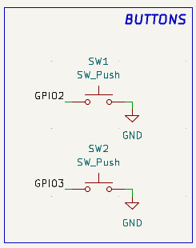

Next, we need to add the screen to display our character.

Search for a generic 01x04 pin and add that to your schematic, then wire it up like so:

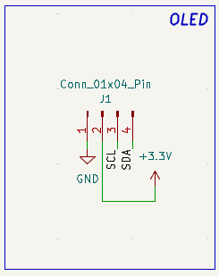

Next add in a generic 01x08 pin to represent the MPU6050 module. This will allow your Starbie to sense itself being moved around:

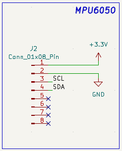

Finally, add in the DHT11 sensor. This will allow your Starbie to sense the temperature and moisture of the environment. (Add a DHT11 symbol.)

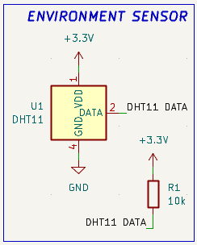

Once all the components are connected, we can start assigning footprints to the symbols we have here. Footprints are what gets physically drawn on the PCB. To do this, click the "run footprint assignment tool" in the top right.

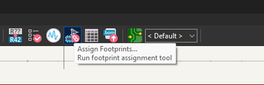

This should open up a window where you can assign different footprints to your components! Assign them based on the image below:

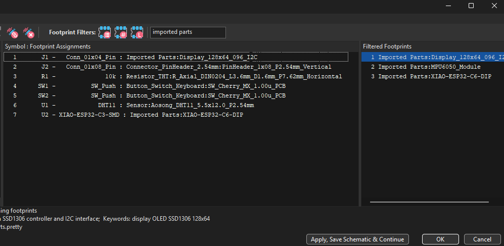

(use the esp32c3 you imported from the Care Package!)

Once you're done, you can hit apply & save schematic. We're now officially done with the schematic! Onto making the physical PCB itself:

## Route the PCB

Go back to KiCad project page, and hit the "PCB editor" button. Once the PCB editor is open, hit the "Update PCB from schematic" button in the top right:

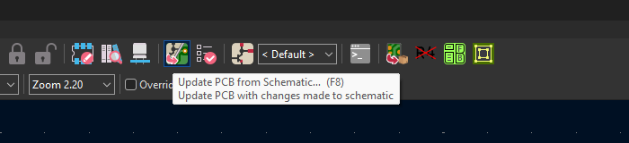

It should have dumped all the components on the page like this:

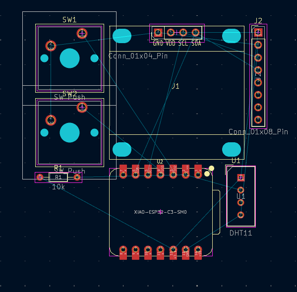

After that, create a custom boundry on the edge cuts layer (again Youtube is your friend here!) and arrange your components inside of it.

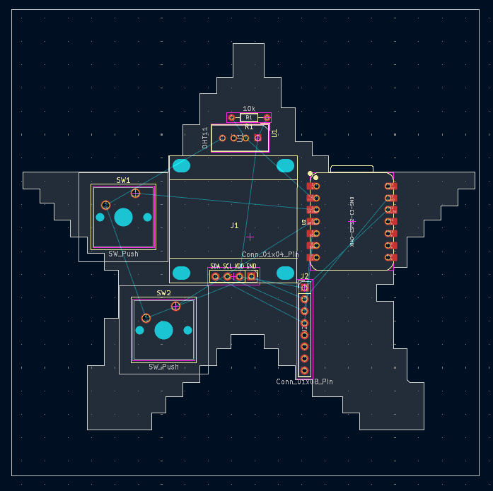

Now it's time to route the PCB! Hit X on your keyboard and hit any golden pad that still has a thin blue line. It should dim the entire screen and show you where to go. Route the PCB like so:

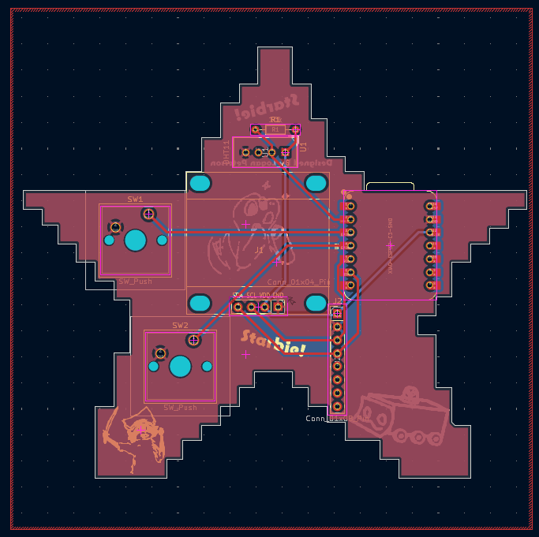

(to get the blue lines, change the layer on the right from F.cu to B.cu)

I've added a GND pour here, if you want more information about how you can use it you can check [this awesome tutorial](https://www.youtube.com/watch?v=DNTgrTukltw).

## Checking for errors:

DRC (or Design Rules Check) is a tool that automatically checks for PCB design mistakes, such as disconnected traces or other various errors.

You can access it via the button on the top right:

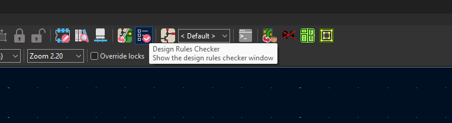

Try running it, you can ignore any warnings but you shouldnt have any errors except for these two:

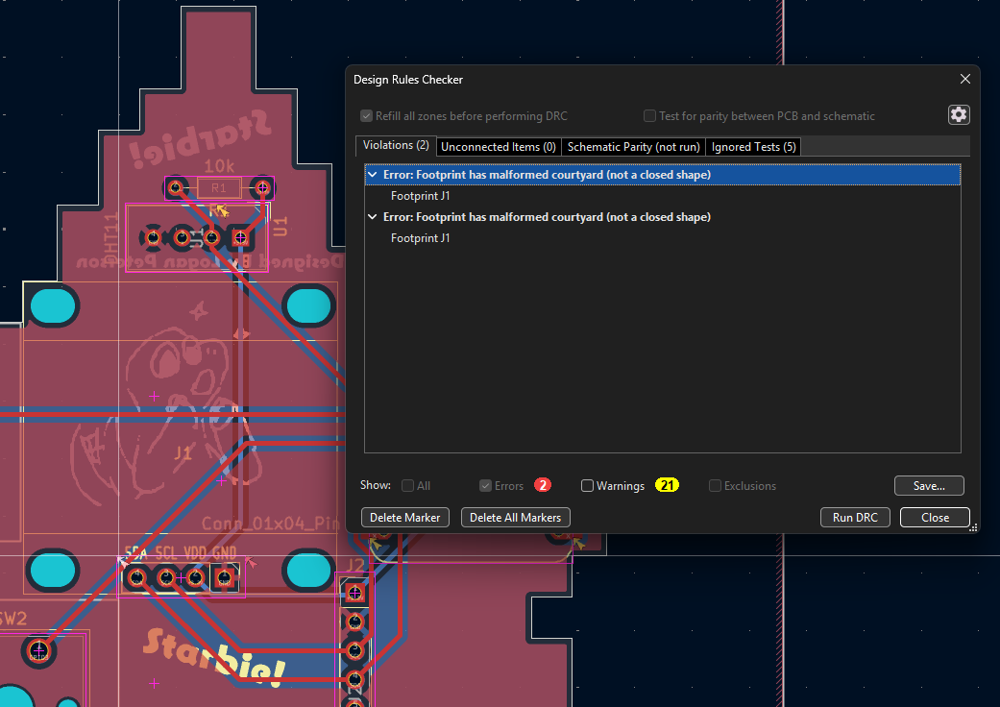

Those two errors say:
`Error: Footprint has malformed courtyard (not a closed shape) - Footprint J1`

Don't panic! That is just an artifact inside the footprint definition from the care package. As long as **Unconnected Items is 0**, your traces are complete and ready to go!

---

## Adding Custom Silkscreen Art

Want to put your own logo, name, or cute pet doodle directly on the board? KiCad has a built-in tool for that!

From the main KiCad Project Manager, click on **Image Converter**:


1. Load any black-and-white PNG image (your custom pet drawing or logo).
2. Set the output format to **Footprint**.
3. Choose the target layer as **Front Silkscreen (`F.Silkscreen`)**.
4. Adjust the dimensions so it fits your board, then export it into your project folder.
5. In the PCB Editor, press `A` to add a footprint, select your converted graphic, and place it wherever you want!

You can press **Alt + 3** (or **View → 3D Viewer**) at any time to see a 3D model of your finished board and make sure everything looks clean!

---

## 1.3 Exporting your PCB (Gerbers)

Before you can send your board to be manufactured (via JLCPCB or PCBWay), you need to export standard **Gerber** and **Drill** files:

### Option A: The Standard KiCad Export
1. In the PCB Editor, go to **File → Fabrication Outputs → Gerbers (.gbr)...**
2. Check the following layers:
   - `F.Cu` and `B.Cu` (Copper layers)
   - `F.Silkscreen` and `B.Silkscreen` (Text & art)
   - `F.Mask` and `B.Mask` (Solder mask)
   - `Edge.Cuts` (Board outline)
3. Click **Plot**.
4. Click **Generate Drill Files...** in the lower-right corner.
5. Keep the defaults and click **Generate Drill File**, then close the window.
6. Open your project folder, find all the generated `.gbr` and `.drl` files, and compress them into a `.zip` archive (e.g. `Starbie_Gerbers.zip`).

### Option B: JLCPCB Tools Plugin
If you have the **JLCPCB Fabrication Toolkit** installed in KiCad, simply click the JLCPCB icon on your top toolbar—it automatically exports the zipped Gerbers directly into `PCB/production/` for you!

You can upload this zip file directly to [JLCPCB](https://jlcpcb.com/) to order your PCBs. Standard 2-layer specs (1.6mm thickness, FR4, HASL) with your favorite soldermask color work great!

---

# Part 2: Firmware!

Now that your PCB design is complete, let's bring Starbie to life with code!

All the firmware is contained in a single beginner-friendly file located at [`Firmware/Starbie/Starbie.ino`](Firmware/Starbie/Starbie.ino).

---

## 1. Setting up Arduino IDE

1. **Install Arduino IDE:** Download and install the latest [Arduino IDE](https://www.arduino.cc/en/software).
2. **Add ESP32 Board Support:**
   - Open **File → Preferences** (or `Cmd + ,` on macOS).
   - In the **Additional boards manager URLs** field, paste:
     ```text
     https://espressif.github.io/arduino-esp32/package_esp32_index.json
     ```
   - Click **OK**.
3. **Install the ESP32 Board Package:**
   - Go to **Tools → Board → Boards Manager...**
   - Search for `esp32` and install **esp32 by Espressif Systems**.
4. **Select Board & Port:**
   - Connect your XIAO ESP32-C3 to your computer using a USB-C cable.
   - Go to **Tools → Board → esp32** and select **XIAO_ESP32C3**.
   - Go to **Tools → Port** and select the serial port for your board.
5. **Install Required Libraries:**
   - Go to **Sketch → Include Library → Manage Libraries...**
   - Search for and install:
     - **Adafruit SSD1306**
     - **Adafruit GFX Library**
     - **Adafruit MPU6050**
     - **DHT sensor library** (by Adafruit)
   - When Arduino prompts to install missing dependencies (such as *Adafruit Unified Sensor* or *Adafruit BusIO*), choose **Install All**.

---

## 2. Flashing Starbie

1. Open [`Firmware/Starbie/Starbie.ino`](Firmware/Starbie/Starbie.ino) in Arduino IDE.
2. Click the **Upload** button (the right arrow in the top toolbar).
3. Wait for compilation and flashing to complete.
4. Once the upload finishes, your OLED screen will illuminate and Starbie will greet you!

---

## 3. Controls & Interaction

- **Button 1 (Menu & Confirm):**
  - Press once to open the **Radial Menu**.
  - Physical tilt navigation: Tilt your Starbie board in any direction to move the selector ball toward one of the 4 actions:
    - **TOP:** `NAP` (Puts Starbie to sleep with Zs)
    - **RIGHT:** `PLAY` (Runs two fast laps + joy boost)
    - **BOTTOM:** `FEED` (Wiggles, jumps, and refills fullness)
    - **LEFT:** `PET` (Emits floating hearts)
  - Press **Button 1** again to execute the highlighted action!
- **Button 2 (Stats HUD):**
  - Press to toggle the live stats overlay (**Joy**, **Energy**, and **Fullness** bars).
  - Also shows live temperature and humidity readings from your DHT11 sensor!
- **Motion & Shaking:**
  - Starbie responds to motion! Give the board a friendly physical shake to play with Starbie and give it an instant Joy boost.

---

## 4. Customizing Your Pet

All beginner settings are placed conveniently at the very top of `Starbie.ino`:

```cpp
// --- Starting stats (0 to 100) ---
const int STARTING_JOY = 70;
const int STARTING_ENERGY = 75;
const int STARTING_FULLNESS = 65;

// Set to false if you built your Starbie without the DHT11 sensor
const bool USE_DHT11 = true;

// MPU6050 Orientation helpers:
const bool SWAP_MPU_AXES = false;
const float MENU_X_DIRECTION = 1.0f;
const float MENU_Y_DIRECTION = -1.0f;
```

### Changing the Pet Sprite:
To replace Starbie with your own custom character:
1. Draw a **32x32 pixel** monochrome icon using your favorite pixel editor (Aseprite, Piskel, or Photoshop).
2. Go to [image2cpp](https://javl.github.io/image2cpp/).
3. Upload your image, set canvas size to `32 x 32`, and choose **Horizontal - 1 bit per pixel**.
4. Generate the code and replace the `PET_SPRITE[]` array inside `Starbie.ino` with your new byte data!

---

## 5. Web Simulator

Don't have your hardware soldered yet? You can test the exact Starbie firmware logic in your web browser!

Open [`Firmware/simulator.html`](Firmware/simulator.html) in Chrome or Firefox. It simulates the OLED display, the 3D draggable board with MPU tilt sensing, the push buttons, and the DHT11 environmental readings!

---

## 6. What's Next?

Once your Starbie is assembled, flashed, and running:
- Share pictures and videos in Hack Club Slack's **#half-life** channel!
- Experiment with adding new menu reactions, sounds, or animations.
- Happy hacking!